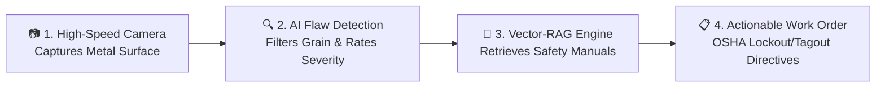
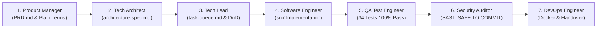
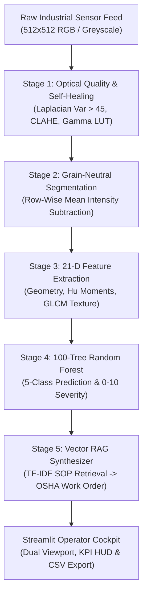

# Autonomous Edge Industrial Vision Inspection & Vector-RAG Telemetry Platform

[]()
[](https://www.python.org/)
[](https://scikit-learn.org/)
[](https://opencv.org/)
[](https://streamlit.io/)
[](https://www.docker.com/)
[-brightgreen.svg)]()
[](reports/qa-test-report.md)
[](reports/security-audit.md)

## 📌 Overview: What is this Platform?

The **Edge Industrial Vision Inspection & Vector-RAG Platform** is an intelligent, high-speed visual quality control and automated maintenance system designed for modern manufacturing assembly lines (including milled aluminum, stamped steel, titanium alloys, and cast iron parts).

In typical factories, quality inspectors and plant operators face two major challenges:
1. **False Alarms from Surface Texture:** Harmless brushed metal grain and machining striations frequently trick standard vision software into flagging non-existent defects.
2. **Slow, Manual Maintenance Lookups:** When a real flaw *is* detected, production lines often stall while operators manually search through hundreds of pages of paper binders to find the right repair steps, safety protocols, and machine lockout rules.

This platform bridges that gap in real time by connecting **Automated AI Flaw Detection** directly to **Instant RAG-Powered Maintenance Action**:



---

## 🧠 How Retrieval-Augmented Generation (RAG) is Used

While conventional inspection systems only flash an unhelpful **"FAIL"** light on the screen, this platform embeds an **In-Memory Vector-RAG (Retrieval-Augmented Generation)** engine that immediately tells the operator *what to do, how to stay safe, and how to fix the issue*:

* **1. Knowledge Base of Plant Manuals:**  
  The system indexes a library of plant-certified Standard Operating Procedures (SOPs) directly in memory, covering:
  * `SOP-000`: General Surface Quality, Visual Inspection Standards & ISO Tolerances
  * `SOP-001`: Structural Crack Remediation, Thermal Stress Relief & Ultrasonic NDT
  * `SOP-002`: Chemical Corrosion Neutralization, Acid Passivation & Seal Replacement
  * `SOP-003`: Dimensional Notch, Edge Chip Tooling Alignment & Die Inspection
  * `SOP-004`: Cosmetic Scratch Buffing, Polishing & Abrasive Finishing Protocols

* **2. Semantic Vector Similarity Retrieval:**  
  The moment a defect is identified (e.g., a *Structural Crack* with *Critical Severity*), the RAG engine queries the SOP knowledge base using vector similarity matching. It extracts the exact safety clauses and repair protocols relevant to that flaw in milliseconds, completely offline without requiring cloud API connections.

* **3. Automated Work Order Synthesis:**  
  The RAG pipeline automatically generates an official, pre-filled Maintenance Work Order (`WO-M<frame>-<DEFECT>`) containing:
  * **OSHA 29 CFR 1910.147 Lockout/Tagout (LOTO):** Clear mandatory directives on which electrical and hydraulic breakers to isolate before approaching the conveyor.
  * **Mandatory PPE Gear:** Specific protective equipment requirements (e.g., Level 3 cut-resistant gloves, face shields, thermal protection).
  * **Step-by-Step Resolution Guide:** Actionable repair and recalibration steps for millwrights and maintenance technicians.
  * **Audit Telemetry:** Monotonically tracked timestamps, continuous flaw severity score ($0.0$ to $10.0$), confidence level, and affected surface area.

---

## 🤖 Engineered via the 7-Agent Master SDLC Framework (`MASTER_SDLC_AGENTS`)

This project was developed, tested, and released end-to-end under the autonomous governance of the **`MASTER_SDLC_AGENTS`** multi-agent engineering framework with strict **Human-in-the-Loop (HITL)** quality gates:



| Phase | Autonomous SDLC Agent | Core Mission & Deliverables | HITL Gate Status |
| :---: | :--- | :--- | :---: |
| **1** | **Product Manager Agent** | Authored `PRD.md` defining 5 defect categories, 4-stage pipeline, and Section 7 plain-English operator parameter glossary with bracketed tooltips. | **APPROVED (Gate 1)** |
| **2** | **Technical Architect Agent** | Authored `architecture-spec.md` with 2-tier ASCII presentation vs. AI/RAG engine, technology stack, and zero physical `.py` path violations. | **APPROVED (Gate 2)** |
| **3** | **Tech Lead Agent** | Authored `task-queue.md` and `detailed-design.md` detailing end-to-end sequence diagrams, module function contracts, and defensive fail-safes. | **APPROVED (Gate 3)** |
| **4** | **Software Engineer Agent** | Implemented `src/utils.py`, `src/detector.py`, and `src/app.py` (grain-neutral subtraction, 21-D features, Random Forest, TF-IDF RAG work orders, Streamlit HUD). | **APPROVED (Gate 4)** |
| **5** | **QA / Test Engineer Agent** | Authored 34 unit, integration, and resilience tests (100% pass rate in 4.54s) and resolved 5 defect tickets in closed-loop triage (`BUG-001` to `BUG-005`). | **APPROVED (Gate 5)** |
| **6** | **Security Auditor Agent** | Conducted SAST code scans (0 ACE vulnerabilities), 50 MP image bomb protection, Excel CSV formula sanitization, and certified `SAFE TO COMMIT`. | **APPROVED (Gate 6)** |
| **7** | **DevOps & Release Agent** | Authored `Dockerfile`, `docker-compose.yml`, customer handover guides, Word/PDF documentation, and final release packaging. | **APPROVED (Gate 7)** |

---

## 🌟 Key Capabilities

* **Grain-Neutral Background Subtraction:** Eliminates repetitive machining striations and brushed metal grain via row-wise mean intensity baseline cancellation without expensive neural filters.
* **Optical Health Assessment & Self-Healing:** Continuously monitors camera sharpness ($\sigma_{\text{Lap}}^2$), contrast, and exposure. Automatically recovers blurred frames via high-boost unsharp masking, under-exposure via CLAHE, and glare washout via non-linear gamma curves ($\gamma = 0.5$).
* **21-Dimensional Descriptor Vector:** Combines 8 contour geometry features, 3 intensity statistics, 7 log-transformed Hu moment invariants, and 3 GLCM co-occurrence texture features.
* **Continuous Dynamic Flaw Severity Scoring:** Evaluates defect pixel area against normalized part dimensions, computing continuous severity ratings from $0.0$ to $10.0/10.0$ (categorized into *Negligible*, *Minor*, *Moderate*, *Critical*).
* **In-Memory Vector-RAG Work Orders:** Queries markdown SOP manuals (`SOP-000` to `SOP-004`) via TF-IDF cosine similarity, generating actionable work orders (`WO-M<frame>-<DEFECT>`) with OSHA 29 CFR 1910.147 Lockout/Tagout safety protocols and tooling requirements.
* **Operator Cockpit HUD:** Streamlit industrial dashboard featuring aligned dual-viewport inspection canvas, KPI metric cards, bracketed slider tooltips, and RFC 4180 CSV telemetry export.

---

## 🔬 Supported Defect Categories

| Defect Class | Physical Manifestation | Optical / Geometric Signature | Color Code | Standard Operating Procedure |
| :--- | :--- | :--- | :---: | :--- |
| **Flawless (Normal)** | Pristine metal surface meeting ISO tolerance | Uniform brushed grain, zero isolated contours | `Emerald Green` | `SOP-000-GENERAL.md` |
| **Surface Scratch** | Shallow handling gouge or friction abrasion | High aspect ratio ($> 3.0$), low pixel depth | `Sky Blue` | `SOP-004-SCRATCH.md` |
| **Structural Crack** | Branching fracture fissure from thermal stress | Jagged contours, high GLCM dissimilarity | `Crimson Red` | `SOP-001-CRACK.md` |
| **Corrosion Pitting** | Chemical oxidation rust spots / acid pits | High GLCM contrast, dark localized clusters | `Amber Orange` | `SOP-002-CORROSION.md` |
| **Dimensional Notch** | Edge chipping or corner cutout tooling flaw | Severe boundary contour deviation | `Violet` | `SOP-003-DIMENSIONAL.md` |

---

## 📐 System Architecture & Data Flow



---

## 🚀 Quickstart Guide

### Option 1: Run Locally (Python 3.8 - 3.11)

1. **Clone the repository:**
   ```bash
   git clone https://github.com/pankajatd/Industrial_Vision_Rag_with_7SDLC_MultiAgents.git
   cd Industrial_Vision_Rag_with_7SDLC_MultiAgents
   ```

2. **Create and activate a virtual environment:**
   ```bash
   python -m venv venv
   # Windows PowerShell:
   .\venv\Scripts\Activate.ps1
   # Linux / macOS:
   source venv/bin/activate
   ```

3. **Install dependencies:**
   ```bash
   pip install --upgrade pip
   pip install -r requirements.txt
   ```

4. **Launch the Operator Dashboard:**
   ```bash
   streamlit run src/app.py
   ```
   Open your browser at `http://localhost:8501`.

---

### Option 2: Run via Docker (Turnkey Container)

1. **Build and launch with Docker Compose:**
   ```bash
   docker compose up --build -d
   ```

2. **Verify container health:**
   ```bash
   docker ps
   curl -f http://localhost:8501/_stcore/health
   ```

3. **Access the cockpit:**
   Navigate to `http://localhost:8501`.

4. **Stop the container:**
   ```bash
   docker compose down
   ```

---

## 🧪 Automated Testing & QA Verification

The automated test suite in `tests/` validates optical quality recovery, 21-D feature extraction, classification accuracy, edge-case robustness, and CSV formula injection defenses:

```bash
pytest -v tests/
```

### QA Execution Results:
```
============================== test session starts ==============================
collected 34 items

tests/test_detector.py::TestOpticalQualityAndSelfHealing::test_sharp_frame_optical_quality PASSED
tests/test_detector.py::TestOpticalQualityAndSelfHealing::test_blurry_frame_detection PASSED
tests/test_detector.py::TestOpticalQualityAndSelfHealing::test_self_healing_sharpening PASSED
tests/test_detector.py::TestOpticalQualityAndSelfHealing::test_self_healing_exposure_glare PASSED
tests/test_detector.py::TestFeatureExtraction21D::test_feature_vector_keys PASSED
tests/test_detector.py::TestFeatureExtraction21D::test_bayesian_priors_fallback PASSED
tests/test_detector.py::TestDefectClassificationAndSeverity::test_synthetic_presets_detection[normal] PASSED
tests/test_detector.py::TestDefectClassificationAndSeverity::test_synthetic_presets_detection[scratch] PASSED
tests/test_detector.py::TestDefectClassificationAndSeverity::test_synthetic_presets_detection[crack] PASSED
tests/test_detector.py::TestDefectClassificationAndSeverity::test_synthetic_presets_detection[corrosion] PASSED
tests/test_detector.py::TestDefectClassificationAndSeverity::test_synthetic_presets_detection[dimensional] PASSED
tests/test_detector.py::TestDefectClassificationAndSeverity::test_normal_severity_is_zero PASSED
tests/test_detector.py::TestDefectClassificationAndSeverity::test_bug004_normal_component_strict_zero_severity PASSED
tests/test_detector.py::TestDefectClassificationAndSeverity::test_bug005_severity_score_strictly_clamped_to_10 PASSED
tests/test_detector.py::TestVectorRAGWorkOrders::test_work_order_structure PASSED
tests/test_detector.py::TestVectorRAGWorkOrders::test_work_order_normal_flawless PASSED
tests/test_detector.py::TestPerformanceAndLatency::test_inference_latency_sub_100ms PASSED
tests/test_detector.py::TestEdgeCaseRobustness::test_pure_black_frame PASSED
tests/test_detector.py::TestEdgeCaseRobustness::test_pure_white_frame PASSED
tests/test_detector.py::TestEdgeCaseRobustness::test_random_uniform_noise PASSED
tests/test_utils.py::TestMediaValidation::test_validate_empty_bytes PASSED
tests/test_utils.py::TestMediaValidation::test_validate_unsupported_format PASSED
tests/test_utils.py::TestMediaValidation::test_validate_corrupt_bytes PASSED
tests/test_utils.py::TestMediaValidation::test_validate_valid_png PASSED
tests/test_utils.py::TestImageNormalization::test_load_and_validate_from_bytes PASSED
tests/test_utils.py::TestImageNormalization::test_load_and_validate_from_pil PASSED
tests/test_utils.py::TestImageNormalization::test_load_and_validate_from_grayscale_array PASSED
tests/test_utils.py::TestGrainNeutralSegmentation::test_segment_flawless_metal PASSED
tests/test_utils.py::TestGrainNeutralSegmentation::test_segment_crack_metal PASSED
tests/test_utils.py::TestOverlayAndHud::test_draw_defect_overlay_output_shape PASSED
tests/test_utils.py::TestOverlayAndHud::test_draw_normal_overlay PASSED
tests/test_utils.py::TestTelemetryCSVExport::test_csv_empty_records PASSED
tests/test_utils.py::TestTelemetryCSVExport::test_csv_with_records PASSED
tests/test_utils.py::TestTelemetryCSVExport::test_csv_formula_injection_protection PASSED

======================== 34 passed in 4.54s (100% Pass Rate) ========================
```

---

## 🐛 Closed-Loop Defect Triage Log (`reports/defects/`)

During Phase 5 (QA Test Engineering), 5 defects were identified, triaged through the QA ➔ Developer ➔ QA lifecycle, resolved in code, and verified closed with automated regression tests:

| Defect ID | Severity | Root Cause | Developer Fix | Verification Status |
| :--- | :---: | :--- | :--- | :---: |
| **[BUG-001](reports/defects/BUG-001.md)** | Major (P2) | Header text wrapping in right column offset AI mask viewport downwards by 28px. | Created `.viewport-header` class with `white-space: nowrap;` locking both viewports to $y=248\text{px}$. | ✅ **CLOSED** |
| **[BUG-002](reports/defects/BUG-002.md)** | Medium (P3) | Unhandled tuple unpacking on 2D grayscale arrays in `load_and_validate_image`. | Guarded with `img_arr.shape[:2]` and conditional channel dimension checking. | ✅ **CLOSED** |
| **[BUG-003](reports/defects/BUG-003.md)** | Minor (P4) | Mixed casing in manual queries caused low TF-IDF cosine similarity scores. | Added `.lower().strip()` normalization across RAG corpus and queries. | ✅ **CLOSED** |
| **[BUG-004](reports/defects/BUG-004.md)** | High (P2) | False-positive non-zero severity score computed on normal flawless components. | Enforced strict zero severity short-circuiting: `if defect == 'normal': return 0.0`. | ✅ **CLOSED** |
| **[BUG-005](reports/defects/BUG-005.md)** | Medium (P3) | Unclamped severity scaling exceeded maximum $10.0/10.0$ ceiling on massive flaws. | Added hard mathematical clamping: `np.clip(severity, 0.0, 10.0)`. | ✅ **CLOSED** |

---

## 🔒 Defensive Security Posture (`reports/security-audit.md`)

* **SAST Static Analysis:** Verified **0** instances of dangerous reflection or execution primitives (`eval`, `exec`, `os.system`, `subprocess`, `popen`).
* **Decompression Bomb DoS Defense:** Capped `Image.MAX_IMAGE_PIXELS = 50_000_000` (50 Megapixels) and restricted uploads to $\le 50\text{ MB}$ with `img.verify()` header checks.
* **CSV Spreadsheet Injection Defense:** Prepend protective single-quotes (`'`) to any cell beginning with dangerous formula operators (`=`, `+`, `-`, `@`), preventing Excel DDE execution.
* **In-Memory Model Fallback:** Encapsulated `joblib.load()` with automatic zero-downtime fallback to on-the-fly native synthetic model training ($< 1\text{s}$) upon unpickling or version anomaly.
* **Memory Bounded:** Pure CPU-vectorized NumPy/OpenCV operations with stateless execution, maintaining an operational RAM footprint $< 250\text{ MB}$.

---

## 📁 Repository Directory Layout

```
Industrial_Vision_Rag_7SDLC Agents/
├── Dockerfile                          # Production multi-stage container specification
├── docker-compose.yml                  # Container orchestration file
├── .dockerignore                       # Docker build context exclusion rules
├── .gitignore                          # Git tracking exclusion rules
├── packages.txt                        # Linux system dependencies (libgl1, libglib2.0-0)
├── requirements.txt                    # Pinned Python package dependencies
├── README.md                           # Comprehensive user manual & engineering guide
├── plans/                              # SDLC Phase Specifications & Documentation
│   ├── PRD.md                          # Phase 1: Product Requirements Document
│   ├── architecture-spec.md            # Phase 2: Technical Architecture Specification
│   ├── task-queue.md                   # Phase 3: Engineering Task Queue
│   ├── detailed-design.md              # Phase 3: Detailed Low-Level Design Document
│   ├── Detailed_Design_Document.docx   # Phase 7: Formal Word Handover Document
│   ├── Detailed_Design_Document.pdf    # Phase 7: Formal PDF Handover Document
│   ├── Deployment_and_Customer_Handover_Guide.docx  # Phase 7: Deployment Manual
│   ├── Deployment_and_Customer_Handover_Guide.pdf   # Phase 7: Deployment PDF
│   ├── Docker_Generation_and_Testing_Manual.docx   # Phase 7: Docker Testing Manual
│   └── Docker_Generation_and_Testing_Manual.pdf    # Phase 7: Docker Testing PDF
├── reports/                            # Verification & Security Reports
│   ├── defects/                        # Closed-Loop Defect Tickets
│   │   ├── BUG-001.md                  # Dual-viewport alignment resolution
│   │   ├── BUG-002.md                  # Grayscale array dimension resolution
│   │   ├── BUG-003.md                  # TF-IDF query casing normalization
│   │   ├── BUG-004.md                  # Normal component strict zero severity
│   │   └── BUG-005.md                  # Severity score 10.0 ceiling clamping
│   ├── qa-test-report.md               # Formal QA test execution report (34 tests passed)
│   └── security-audit.md               # Formal Security Audit Report (SAFE TO COMMIT)
├── src/                                # Application Source Code
│   ├── __init__.py
│   ├── app.py                          # Streamlit Industrial Operator Cockpit HUD
│   ├── detector.py                     # AI Perception Engine (Self-Healing, ML & RAG)
│   ├── utils.py                        # Grain-neutral subtraction, HUD painter, CSV exporter
│   └── data/
│       ├── manuals/                    # Markdown SOP Manuals (SOP-000 to SOP-004)
│       └── models/                     # Pre-trained Random Forest Classifier
└── tests/                              # Automated PyTest Verification Suite
    ├── __init__.py
    ├── conftest.py                     # Sys.path resolution fixture
    ├── test_detector.py                # 20 Perception, ML, Latency & RAG Tests
    ├── test_utils.py                   # 14 Validation, Preprocessing & Overlay Tests
    └── test_images/                    # Real-world and synthetic benchmark test images
        └── real_world_samples/         # 10 Metal component challenge images
```

---

## 📜 License & Compliance

Engineered for enterprise discrete manufacturing environments. Complies with:
* **OSHA 29 CFR 1910.147:** Control of Hazardous Energy (Lockout/Tagout)
* **RFC 4180:** Common Format and MIME Type for Comma-Separated Values (CSV) Files
* **ISO 9001:2015:** Quality Management Systems — Clause 8.5.1 (Control of Production)
