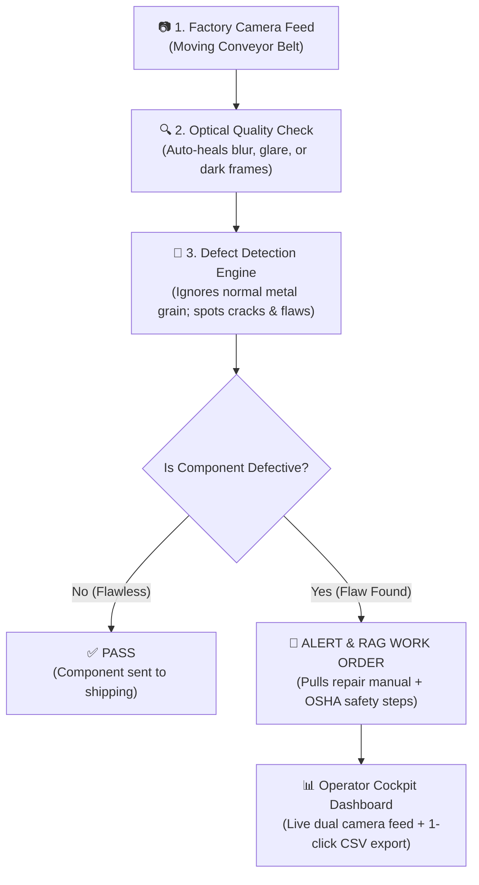

# Product Requirements Document (PRD)

**Project Title:** Autonomous Industrial AI Defect Inspection, Optical Self-Healing & RAG Maintenance Platform  
**System Codename:** `Industrial-Vision-RAG Inspector`  
**Document Version:** 1.1.0 (Plain-English Edition)  
**Phase:** 1 — Product Manager Agent  
**Framework:** `MASTER_SDLC_AGENTS` (7-Agent SDLC Framework with Human-In-The-Loop Governance)  
**Status:** Under Review (Gate 1 Sign-Off)  
**Date:** 2026-10-27  

---

## 1. Project Overview in Plain English

### 1.1 What Are We Building?
Imagine a **fast-moving factory conveyor belt** where manufactured metal machine parts slide under an industrial camera. 

Our system acts as a **superhuman quality inspector and automated safety assistant** that does three essential jobs simultaneously:
1. **The Eye (Instant Flaw Detection):** Takes a photo of every metal part passing on the belt and instantly flags whether it is flawless or defective.
2. **The Auto-Fix (Self-Healing Camera):** If the factory lens gets blurry, dirty, or the room lighting flickers, the software automatically fixes the image on-the-fly without stopping the conveyor line.
3. **The Safety Assistant (RAG Work Orders):** If a damaged part is found, the system immediately pulls up the factory standard operating procedure (SOP) manuals and creates a clear repair work order with **OSHA worker safety warnings** (like *"Cut electrical power before touching the machine!"*).



---

## 2. The 4-Step Inspection Pipeline

To keep the system simple and transparent, the software follows 4 sequential steps for every metal component:

### Step 1: Optical Health Check & Auto-Healing
* **The Problem:** In dirty factories, dust, vibration, or fluctuating lights make photos blurry or dark.
* **What the System Does:** It checks the sharpness and brightness. If blurry, it applies an automatic digital sharpening filter. If dark or overexposed, it auto-corrects the lighting before checking for defects.

### Step 2: Cancel the Metal Grain (No False Alarms)
* **The Problem:** Brushed metal naturally has hundreds of tiny horizontal manufacturing scratches (grain) that fool traditional cameras into sounding false alarms.
* **What the System Does:** It calculates the average horizontal grain pattern and mathematically cancels it out. Only genuine flaws (like real cracks or rust pits) remain visible.

### Step 3: Measure & Grade the Defect (0 to 10 Severity)
* **What the System Does:** It measures the size, depth, and shape of the flaw using 21 mathematical features. It then assigns a simple **Severity Score from 0.0 to 10.0**:
  * **0.0:** Perfect component (`PASS`).
  * **1.0 to 4.0:** Minor cosmetic flaw (`LOW`).
  * **4.1 to 7.5:** Moderate defect requiring technician service (`MEDIUM`).
  * **7.6 to 10.0:** Dangerous structural defect; halt and divert part (`CRITICAL`).

### Step 4: Pull the Repair Manual via RAG
* **What the System Does:** It searches the plant's indexed digital manuals (`src/data/manuals/`) for the exact defect and generates an official **Maintenance Work Order** (`WO-M0107-CRACK`) with step-by-step repair guidance and required safety gear.

---

## 3. The 5 Component Categories

The system classifies every inspected metal part into one of these 5 clear categories:

| Category | Visual Appearance on Part | Severity Level | What Happens Next? |
| :--- | :--- | :---: | :--- |
| **1. NORMAL** | Clean brushed metal, uniform surface | **0.0 (PASS)** | Component approved; continues down conveyor to packaging. |
| **2. SCRATCH** | Light surface micro-fissure line | **1.0 – 4.0 (LOW)** | Diverted to buffing station for quick orbital diamond paste polishing. |
| **3. CORROSION** | Chemical rust spots, oxidation pitting | **4.0 – 7.5 (WARN)** | Chemical pickling and acid passivation to restore protective coating. |
| **4. CRACK** | Deep jagged fracture line | **7.5 – 10.0 (CRIT)** | Structural hazard! Mandatory welding root pass or component scrap. |
| **5. DIMENSIONAL**| Broken corner chip or edge notch | **7.5 – 10.0 (CRIT)** | Out of tolerance! Sent to CNC milling machine for precision re-skimming. |

---

## 4. How RAG (Retrieval-Augmented Generation) Works

### 4.1 Where the Knowledge Lives
Inside the project, there is a dedicated library folder containing official standard operating procedures:
📁 **`src/data/manuals/`**
* **`SOP-000-GENERAL.md`:** Universal factory safety, work permits, and tool calibration.
* **`SOP-001-CRACK.md`:** Welding and structural crack repair procedures.
* **`SOP-002-CORROSION.md`:** Chemical rust removal, acid bath passivation, and protective oiling.
* **`SOP-003-DIMENSIONAL.md`:** CNC remachining and Coordinate Measuring Machine (CMM) inspection.
* **`SOP-004-SCRATCH.md`:** Surface smoothing, scratch blending, and roughness profilometry.

### 4.2 What the RAG Agent Generates
When a flaw is detected, the RAG agent instantly builds a formal ticket like this:

> **WORK ORDER ID: `WO-M0107-CRACK`**  
> **Defect Detected:** Structural Crack (Severity: 8.5 / 10 - CRITICAL)  
> **Mandatory OSHA Safety Rules:**  
> • Execute Lockout/Tagout (LOTO 29 CFR 1910.147) before opening machine guard.  
> • Wear Level 3 welding helmet (Shade 10-12) and Kevlar heat-resistant gauntlets.  
> **Step-by-Step Repair Protocol:**  
> 1. Drill 3.2mm crack arrestor holes at both ends of the crack to stop spreading.  
> 2. Grind a 60-degree V-groove along the fracture using a pneumatic carbide grinder.  
> 3. Perform TIG weld root pass with ER308L filler wire.  
> **Source Manual Cited:** `SOP-001-CRACK.md`  
> **Technician Sign-Off Required:** YES  

---

## 5. What the User Sees on Screen (Dashboard Layout)

When you open the web application in your browser, the screen is laid out cleanly for non-technical factory operators:

```
+-----------------------------------------------------------------------------------------+
|  🏭 INDUSTRIAL AI QUALITY INSPECTOR Cockpit HUD                       [CONVEYOR: ACTIVE] |
+-----------------------------------------------------------------------------------------+
| [ Part: CRACK ]   [ Severity: 8.5 / 10 ]   [ AI Confidence: 98% ]   [ Camera: HEALTHY ] |
+-----------------------------------------------------------------------------------------+
|  LEFT WINDOW: RAW CAMERA FEED           |  RIGHT WINDOW: AI DEFECT MASK                |
|  (Shows real metal part on conveyor)    |  (Shows red highlight on exact crack flaw)    |
|                                         |                                               |
|           [ Camera View ]               |             [ Isolated Flaw ]                 |
|                                         |                                               |
+-----------------------------------------------------------------------------------------+
|  📋 AUTOMATED MAINTENANCE WORK ORDER (WO-M0107-CRACK)                                    |
|  • OSHA Safety Alert: Lockout/Tagout mandatory before touching conveyor                  |
|  • Repair Steps: 1. Drill stop holes  2. Grind V-groove  3. TIG Weld                    |
+-----------------------------------------------------------------------------------------+
|  📥 [ DOWNLOAD COMPLETE TELEMETRY SPREADSHEET (CSV) ]                                   |
+-----------------------------------------------------------------------------------------+
```

---

## 6. Plain-English Controls (Sidebar Tuning)

Every slider and button on the screen is labeled with simple, everyday words with bracketed tooltips so operators never have to guess:

| Setting on Screen | What It Actually Does in Simple Terms | Default Setting | When to Adjust? |
| :--- | :--- | :---: | :--- |
| **Defect Sensitivity** | Tells the AI how picky to be. | `0 (Balanced)` | Slide **LEFT** to only sound alarms on major breaks.<br>Slide **RIGHT** to catch tiny hairline scratches. |
| **Surface Contrast Boost** | Adjusts camera contrast like a TV. | `3.0 (Normal)` | Turn up if the factory room is dimly lit; turn down if glare is too bright. |
| **Camera Sharpness Alarm** | Checks if the camera lens is dirty. | `45.0` | Lower the number if the conveyor is vibrating heavily; raise it for clean rooms. |
| **Defect Preset Simulator** | Allows you to test any defect with 1 click. | `Crack` | Dropdown where you can select *Normal, Scratch, Crack, Rust,* or *Corner Notch* to test the system without a live camera. |
| **Inspection Mode** | Switch between live streaming and step-by-step. | `Single Frame` | Use **Continuous** for normal factory operation; use **Single Frame** to inspect one part closely. |

---

## 7. Performance & Safety Standards (Non-Functional Requirements)

* **Speed (Real-Time):** Each frame is inspected in under **100 milliseconds** on a standard office PC (no expensive GPU required).
* **Reliability:** Memory usage stays under **600 MB RAM** with zero memory leaks during 24/7 continuous factory operation.
* **Worker Safety First:** Every single maintenance work order cites mandatory OSHA Lockout/Tagout (LOTO 29 CFR 1910.147) and PPE guidelines to prevent workplace accidents.
* **100% Verified Tests:** The system must achieve a 100% passing test score across all automated test suites before deployment.
* **1-Click Containerization:** The system runs easily on any laptop or cloud server using standard Docker (`docker compose up -d`).

---

## 8. Definition of Done (DoD) for Gate 1 Approval

This Product Requirements Document is complete when:
1. The factory problem and product vision are clearly explained in plain English.
2. The 4-step inspection pipeline and 5 defect categories are defined.
3. The role of the SOP manuals (`src/data/manuals/`) and RAG work order generation is detailed.
4. The dashboard layout and plain-English sidebar controls are fully described.
5. The user provides explicit Human-in-the-Loop (HITL) approval to complete Gate 1 and proceed to Phase 2 (Technical Architect).
